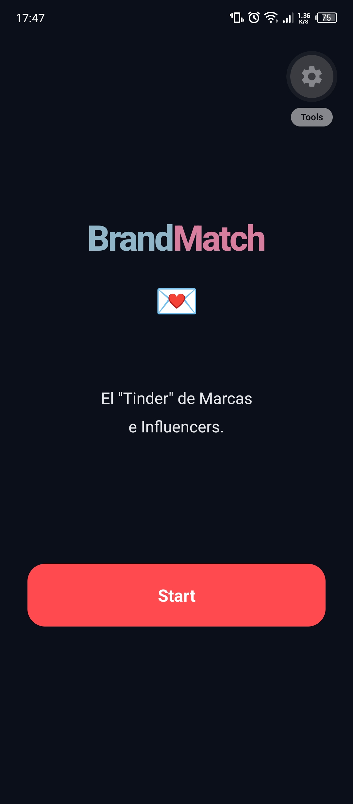
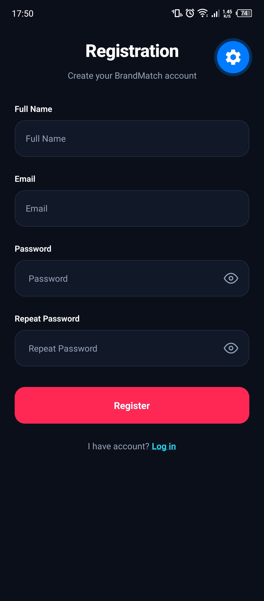
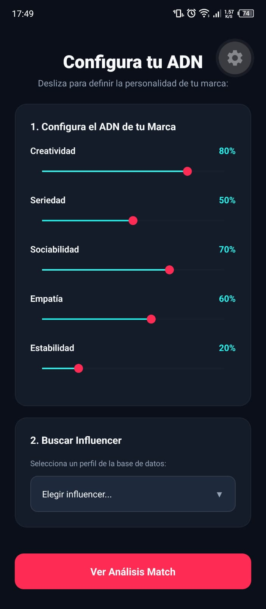

# BrandMatch 🤝 - Plataforma SaaS B2B de Emparejamiento Marca–Creador

**BrandMatch** es una aplicación móvil SaaS B2B que utiliza Inteligencia Artificial y el modelo psicológico **Big Five (OCEAN)** para emparejar marcas con creadores de contenido ideales, midiendo la afinidad real de personalidad y valores por encima de métricas superficiales.

El proyecto está desarrollado en **React Native con Expo Go** bajo una **Arquitectura en Capas orientada al Dominio (DDD)** con principios de **Clean Architecture**, **Inyección de Dependencias** y **Atomic Design**, trasladando el sistema de diseño construido en **Figma** y alimentándose del pipeline de extracción y análisis psicométrico **PractScrapyTtk**.

---

## 🔗 Enlaces Oficiales y Entregables del Proyecto

| Recurso / Entregable | Enlace Directo | Descripción |
| :--- | :--- | :--- |
| **🎨 Prototipo Interactivo (Figma)** | [Ver Prototipo en Figma](https://www.figma.com/proto/hZZLmnQJlWEa1W4fg9ImRf/BrandMatch-Prototipo?node-id=1-2&starting-point-node-id=1%3A2&t=7Y00eWz3GUwOEqPF-1) | Diseño UI/UX completo en Dark Mode (`8px` grid), Atomic Design y vistas responsivas (`9:16`, `16:9`, `1:1`). |
| **📄 Informe Técnico Final** | [Ver Informe Final (`Reporte_Final_BrandMatch.pdf`)](./docs/Reporte_Final_BrandMatch.pdf) | Documento académico completo con fundamentos DDD, arquitectura, pruebas y trazabilidad *(actualizar enlace si se aloja en Drive/OneDrive)*. |
| **📊 Presentación Ejecutiva (Diapositivas)** | [Ver Diapositivas de Sustentación](https://docs.google.com/presentation/d/1fKVn0Se_fRhxd-1JM1vqYXem5NBWvXEQ/edit?usp=sharing&ouid=115547854198529635935&rtpof=true&sd=true) | Presentación del problema, origen de datos, arquitectura `src/` y demostración responsiva *(reemplazar con el enlace final de la presentación)*. |
| **🕷️ Repositorio del Scraper (`PractScrapyTtk`)** | [Ir al repositorio](https://github.com/empulamarin11/PractScrapyTtk.git) | Módulo Extractor TikTok + Groq LLM | Scraper en Python/Playwright que extrae métricas públicas y estima perfiles Big Five. |

---

## 📋 Tabla de Contenido

1. [Presentación, Objetivos y Alcance](#-1-presentación-objetivos-y-alcance)
2. [Problema del Negocio y Pipeline de Datos](#-2-problema-del-negocio-y-pipeline-de-datos)
3. [Modelo de Negocio](#-3-modelo-de-negocio)
4. [Prototipo en Figma, Capturas de Pantalla y Responsividad](#-4-prototipo-en-figma-capturas-de-pantalla-y-responsividad)
5. [Arquitectura de Software y Metodología DDD](#-5-arquitectura-de-software-y-metodología-ddd)
6. [Estructura Real del Repositorio (`src/`)](#-6-estructura-real-del-repositorio-src)
7. [Estado Real del Proyecto](#-7-estado-real-del-proyecto)
8. [Inteligencia Artificial y Prompts Empleados](#-8-inteligencia-artificial-y-prompts-empleados)
9. [Limitaciones Técnicas y Consideraciones Éticas](#-9-limitaciones-técnicas-y-consideraciones-éticas)
10. [Flujo de Trabajo en Git y Responsables](#-10-flujo-de-trabajo-en-git-y-responsables)
11. [Ejecución Local](#-11-ejecución-local)

---

## 🎯 1. Presentación, Objetivos y Alcance

### Objetivo General
Desarrollar un prototipo funcional de aplicación móvil bajo **Domain-Driven Design (DDD)** que permita a las marcas calibrar su identidad psicológica (**ADN Digital**), calcular su nivel de compatibilidad con creadores de contenido perfilados mediante el modelo **Big Five** y generar propuestas comerciales personalizadas (**Pitch**).

### Objetivos Específicos
- Estructurar el código móvil en cuatro capas desacopladas (`domain`, `application`, `infrastructure`, `presentation`) con inversión de dependencias mediante un *Composition Root* (`src/container.js`).
- Integrar perfiles psicográficos obtenidos desde el scraper de TikTok y análisis con LLM (**Groq**) en el dominio de emparejamiento (`src/domain/match/`).
- Implementar reglas de validación inmutables (*Objetos de Valor*) para el flujo de autenticación y registro de marcas.
- Adaptar la interfaz móvil en modo oscuro a relaciones de aspecto **`9:16`**, **`16:9`** y **`1:1`**, manteniendo legibilidad y proporción en distintas resoluciones y densidades de píxeles.

### Delimitación del Alcance

| Incluye (Implementado en el Prototipo) | No Incluye (Fases Posteriores) |
| :--- | :--- |
| Flujo completo de 7 pantallas navegables en Expo Go (`Welcome`, `Login`, `Registro`, `ForgotPassword`, `Configuracion`, `Match`, `Pitch`). | Conexión en tiempo real a un servidor backend o base de datos relacional en la nube. |
| Validaciones de dominio puras e inmutables (`Email`, `FullName`, `Password`, `NewPassword`) y manejo tipado de errores (`ValidationError`, `NotConfiguredError`). | Autenticación OAuth real con proveedores externos (Apple / Google Sign-In) ni envío real de correos de recuperación. |
| Calibración interactiva de 5 rasgos de marca (`0%–100%`), catálogo de creadores perfilados con Big Five y cálculo matemático de compatibilidad. | Diagnóstico psicológico clínico validado (los puntajes Big Five son estimaciones comerciales orientativas). |
| Visualización vectorial pentagonal (`RadarChart.js` en SVG) y generación dinámica de *Pitch* con copiado al portapapeles. | Envío automatizado de correos B2B desde la app ni extracción en vivo desde TikTok dentro del dispositivo móvil. |

---

## 🔍 2. Problema del Negocio y Pipeline de Datos

### El Problema
En el marketing de influencers actual, las decisiones suelen tomarse por intuición o métricas vanidosas (número bruto de seguidores), lo que genera tres fallos críticos:
- **El 60% de las campañas fracasan** por desalineación entre los valores de la marca y la personalidad real del creador.
- **Inflación de métricas:** El volumen de seguidores no garantiza afinidad comunicativa ni conexión auténtica con la audiencia.
- **Selección manual e inescalable:** Evaluar perfiles uno por uno consume tiempo y carece de criterios objetivos auditables.

### Origen de los Datos: Evolución del Scraper (`PractScrapyTtk`) a `BrandMatch`
La información de los creadores que alimenta `src/domain/match/Influencer.js` proviene de un pipeline previo de extracción y análisis psicométrico desarrollado desde cero en Python:

1. **Extracción Pública (Playwright):** Navegación automatizada sin APIs oficiales leyendo el bloque `#__UNIVERSAL_DATA_FOR_REHYDRATION__` e interceptando respuestas XHR de TikTok.
2. **Análisis Paralingüístico (`emoji`):** Conteo de emojis en biografías y descripciones de videos para detectar señales emocionales.
3. **Inferencia Big Five (API de Groq):** Evaluación de rasgos **OCEAN** (*Apertura, Responsabilidad, Extraversión, Amabilidad y Neuroticismo*) y asignación de un **arquetipo comunicativo** por creador.

| Versión Inicial (`PractScrapyTtk` — Web/CLI) | Evolución Actual (`BrandMatch` — App Móvil DDD) |
| :--- | :--- |
| Script monolítico en Python con dashboard en Streamlit. | Aplicación móvil multiplataforma en React Native + Expo Go con arquitectura DDD en 4 capas. |
| Muestra los rasgos Big Five del creador de forma aislada. | Cruza el perfil Big Five del creador contra los 5 rasgos calibrados por la marca (`MatchCalculator.js`). |
| Exportación estática a archivos `resultado_*.json`. | Repositorio desacoplado (`InfluencerRepository.js`) que abstrae el origen de datos para la UI móvil. |
| Análisis descriptivo sin herramienta de contacto comercial. | Generación inmediata de propuesta B2B (*Pitch*) lista para copiar y enviar al creador. |

---

## 💼 3. Modelo de Negocio

| Elemento | Descripción |
| :--- | :--- |
| **Segmento de Clientes** | Marcas, emprendimientos y agencias de marketing digital que contratan creadores de contenido. |
| **Propuesta de Valor** | Reducir el riesgo de campañas fallidas mediante emparejamiento psicográfico objetivo (Big Five) y generación instantánea de propuestas comerciales. |
| **Canales** | Aplicación móvil multiplataforma (Android / iOS vía Expo Go) respaldada por motor web de extracción de datos. |
| **Fuentes de Ingresos** | Modelo SaaS B2B: suscripción mensual escalonada según volumen de búsquedas/matches y planes corporativos para agencias. |
| **Recursos Clave** | Pipeline de extracción de datos públicos, motor de inferencia Big Five con IA, algoritmo de compatibilidad y Design System móvil. |
| **Diferenciador** | Sustituye la selección superficial por seguidores con compatibilidad de personalidad medible en 5 dimensiones y un flujo móvil de 3 pasos (*Configurar → Analizar → Contactar*). |

---

## 🎨 4. Prototipo en Figma, Capturas de Pantalla y Responsividad

### 4.1 Capturas de la Aplicación Móvil (Expo Go — Formato `9:16`)

| Bienvenida (`Welcome`) | Autenticación (`Login`) | Registrarse (`Registro`) |
| :---: | :---: | :---: |
|  |  |  |

| Configuración ADN (`Configuracion`) | Análisis de Match (`Match`) | Generador de Pitch (`Pitch`) |
| :---: | :---: | :---: |
|  |  |  |

### 4.2 Evidencias del Prototipo en Figma y Pruebas Responsivas (`16:9` y `1:1`)

| Sistema Atómico en Figma (Atomic Design) | Prueba en Formato `16:9` (Horizontal) | Prueba en Formato `1:1` (Cuadrado / Split) |
| :---: | :---: | :---: |
|  |  |  |

*(Nota: Guardar las capturas del lienzo de Figma y de las pruebas en orientación horizontal/cuadrada en `assets/screenshots/` con esos nombres para su visualización automática).*

### 4.3 Mapeo de Pantallas, Atomic Design y Contextos DDD

| # | Pantalla | Acción del Usuario | Nivel Atomic Design / Componentes | Contexto DDD Asociado |
| :---: | :--- | :--- | :--- | :--- |
| 1 | `WelcomeScreen` | Visualiza la propuesta de valor e inicia el flujo. | Página con animaciones nativas (`Animated`) y scroll responsivo. | Presentación / Entrada |
| 2 | `loginScreen` | Ingresa credenciales para acceder al espacio de trabajo. | Página + Átomos `EyeIcon`, `EyeOffIcon`, `AppleIcon`, `GoogleIcon`. | Identidad y Acceso (`auth`) |
| 3 | `RegistroScreen` | Crea una cuenta nueva validando nombre, correo y contraseña. | Página + Validación reactiva por campo (`ValidationError`). | Identidad y Acceso (`auth`) |
| 4 | `ForgotPasswordScreen` | Solicita enlace de recuperación de contraseña. | Página + Manejo de errores de dominio (`NotConfiguredError`). | Identidad y Acceso (`auth`) |
| 5 | `ConfiguracionScreen` | Calibra los 5 sliders de marca y elige un influencer en el modal. | Organismo (Sliders + `Modal` `FlatList` + `CustomButton`). | Perfilamiento y Match (`match`) |
| 6 | `MatchScreen` | Evalúa el porcentaje de afinidad y el pentágono Big Five. | Organismo (`RadarChart` SVG + Tarjetas métricas + `CustomButton`). | Emparejamiento (`match`) |
| 7 | `PitchScreen` | Revisa y copia el correo personalizado de colaboración. | Página + Tarjeta de propuesta + `CustomButton` + `Clipboard`. | Emparejamiento (`match`) |

### 4.4 Adaptación a Relaciones de Aspecto (`9:16`, `16:9` y `1:1`) y Densidad de Píxeles

| Variable de Pantalla | Implementación Técnica en React Native |
| :--- | :--- |
| **Relación `9:16` (Vertical)** | Estructura vertical adaptable con `SafeAreaView` y `ScrollView` que respeta barras de estado y gestos del sistema. |
| **Relación `16:9` (Horizontal)** | Hook `useWindowDimensions()` para compactar espaciados verticales en `WelcomeScreen` (evitando recortes del botón *Start*) y contenedores centrados (`maxWidth: 480` en autenticación y `maxWidth: 600` en pantallas principales) para evitar estiramiento horizontal. |
| **Relación `1:1` (Cuadrado)** | Dimensionamiento dinámico del gráfico de radar mediante `Math.min(width, height)` para que el pentágono SVG y sus 5 etiquetas se reescalen sin salirse de su tarjeta en ventanas cuadradas o pantalla dividida. |
| **Resolución y Densidad (`dp`)** | Todas las dimensiones y tipografías emplean **píxeles independientes de densidad (`dp`)** escalados automáticamente según el `PixelRatio` del dispositivo (`mdpi`, `xhdpi`, `xxhdpi`), mientras que `RadarChart` y `AuthIcons` son gráficos vectoriales (`react-native-svg`) libres de pixelación. |

---

## 🏗️ 5. Arquitectura de Software y Metodología DDD

El proyecto implementa una **arquitectura en capas basada en Domain-Driven Design (DDD)**, alineada con los principios de **Clean Architecture**, complementada con **Inyección de Dependencias** para el desacoplamiento de servicios y **Atomic Design** para la construcción modular de la interfaz.

### 1. Capas arquitectónicas

| Capa | Directorio | Rol arquitectónico | Componentes implementados |
|:--|:--|:--|:--|
| **1. Dominio** | `src/domain/` | El núcleo puro. Reglas de negocio, validaciones y cálculos matemáticos sin dependencias de React ni librerías externas. | `Email.js`, `Password.js`, `FullName.js`, `NewPassword.js`, `AuthRepository.js`, `Influencer.js`, `MatchCalculator.js`, `PitchGenerator.js`, `BrandProfile.js` |
| **2. Aplicación** | `src/application/` | Orquestadores. Casos de uso que reciben datos de la vista, ejecutan reglas del dominio y coordinan la infraestructura. | `loginUser.js`, `registerUser.js`, `calculateMatch.js`, `generatePitch.js`, `saveBrandProfile.js` |
| **3. Infraestructura** | `src/infrastructure/` | El exterior. Adaptadores técnicos, repositorios de datos y conexión con APIs externas (actualmente simuladas). | `AuthApi.js`, `InfluencerRepository.js`, `AiApi.js` |
| **4. Presentación** | `src/presentation/` | Lo visual. Renderiza pantallas, gestiona rutas y captura eventos táctiles en React Native. | `components/`, `navigation/`, `screens/`, `theme/` |

### 2. Patrones complementarios

- **Inyección de Dependencias (`src/container.js`):** actúa como *Composition Root*, instanciando los servicios de infraestructura (`AuthApi`, `InfluencerRepository`, `AiApi`) e inyectándolos en los casos de uso para evitar el acoplamiento directo desde las vistas.
- **Atomic Design y Design System (`src/presentation/`):** organiza la UI por jerarquía de reutilización: tokens globales (`theme/colors.js`), átomos y moléculas (`CustomButton`, `RadarChart`), páginas (`screens/`) y navegación nativa (`navigation/AppNavigator`).
- **Regla de dependencia hacia adentro:** toda la lógica psicográfica (Big Five) y las reglas de validación residen aisladas en `src/domain/`, lo que permite sustituir en el futuro las APIs simuladas por un backend real sin alterar la interfaz gráfica.

### 3. Flujo de la aplicación

```
Welcome ──► Login ──► Configuración ADN ──► Análisis de Match ──► Pitch IA
              │
              └──► Registro
```

---

## 🤖 8. Inteligencia Artificial y Prompts Empleados

### 8.1 IA dentro del Producto vs. IA en el Desarrollo

| Herramienta / Modelo | Ámbito | Rol Técnico en el Proyecto |
| :--- | :--- | :--- |
| **Groq LLM (`PractScrapyTtk`)** | **Dentro del producto** | Procesa biografías, descripciones de videos y emojis extraídos de TikTok para puntuar los rasgos Big Five (`0–100`) y clasificar el arquetipo del creador. |
| **Gemini (Google)** | **Durante el desarrollo** | Prompt maestro de concepción del producto SaaS B2B, flujo de pantallas, arquitectura DDD en capas y adaptación responsiva (`9:16`, `16:9`, `1:1`). |
| **Claude (Anthropic)** | **Durante el desarrollo** | Diseño táctico del subdominio `auth`, objetos de valor inmutables (`Email`, `NewPassword`), manejo de errores y *Composition Root* (`src/container.js`). |
| **DeepSeek** | **Durante el desarrollo** | Implementación de pantallas interactivas (`ConfiguracionScreen`, `MatchScreen`, `PitchScreen`), `MatchCalculator.js` y geometría SVG de `RadarChart.js`. |
| **OpenAI Codex / GitHub Copilot** | **Durante el desarrollo** | Asistencia en VS Code para iconos vectoriales (`AuthIcons.js`), animaciones nativas (`Animated`) y tokens visuales en `colors.js`. |

### 8.2 Jerarquía de Prompts Empleados

1. **Nivel 1 — Prompt Maestro de Arquitectura y Producto (`Gemini`):**
   > *"Actúa como arquitecto de producto digital y desarrollador móvil senior. A partir de los datos extraídos del mercado —el 60% de las campañas de influencer marketing fracasan porque las marcas seleccionan creadores solo por seguidores/likes sin evaluar afinidad de valores—, genera la propuesta completa de negocio y la estructura base de una aplicación móvil SaaS B2B llamada BrandMatch desarrollada en React Native con Expo Go. El sistema debe: 1) Analizar los 5 rasgos de personalidad del modelo psicológico Big Five (Apertura, Responsabilidad, Extraversión, Amabilidad y Neuroticismo); 2) Mapear el flujo completo en 7 pantallas (Welcome, Login, Registro, Recuperar Contraseña, Configuración de ADN con sliders, Análisis de Match con gráfico de radar y Generador de Pitch); y 3) Organizar el código bajo Domain-Driven Design (DDD) en 4 capas (`domain`, `application`, `infrastructure`, `presentation`) junto con Atomic Design en modo oscuro (`#0B0F19`, acento cian `#25F4EE` y magenta `#FE2C55`)."*

2. **Nivel 2 — Andamiaje de Dominio e Inyección de Dependencias (`Claude`):**
   > *"Implementa bajo DDD el subdominio `auth` en JavaScript puro sin importar librerías de React. Crea objetos de valor inmutables (`Email`, `Password`, `FullName`, `NewPassword`) con validación estática, errores tipados (`ValidationError`, `NotConfiguredError`), el contrato `AuthRepository`, el adaptador `AuthApi` y los casos de uso (`makeLoginUser`, `makeRegisterUser`, `makeRequestPasswordReset`) conectados mediante un Composition Root en `src/container.js`."*

3. **Nivel 3 — Motor Matemático Big Five, Sliders y Gráfico Radar SVG (`DeepSeek`):**
   > *"Desarrolla `MatchCalculator.js`, `ConfiguracionScreen.js` y `MatchScreen.js` en React Native con Expo Go. Usa `@react-native-community/slider` para calibrar los 5 rasgos de marca, un `Modal` con `FlatList` alimentado por `getInfluencers()` y `react-native-svg` con `useWindowDimensions()` para dibujar el pentágono Big Five en `RadarChart.js` adaptable a relaciones de aspecto `9:16`, `16:9` y `1:1` sin recortes ni desbordamientos."*

4. **Nivel 4 — Generador de Pitch Comercial y Microinteracciones (`DeepSeek` / `Codex`):**
   > *"Implementa `PitchScreen.js` y el átomo reutilizable `CustomButton.js` con animaciones nativas (`Animated.spring` con `useNativeDriver: true`). En `PitchScreen`, recibe el perfil del creador seleccionado, redacta dinámicamente la propuesta comercial B2B personalizada con su nombre y arquetipo comunicativo y permite copiarla al portapapeles con `Clipboard.setString`."*

---

## ⚖️ 9. Limitaciones Técnicas y Consideraciones Éticas

### Limitaciones Técnicas
- **Naturaleza orientativa del perfil:** La estimación Big Five se basa en análisis textual de publicaciones públicas y funciona como apoyo comercial, no como un test psicométrico clínico.
- **Dependencia de texto:** Perfiles sin biografía ni descripciones textuales en sus videos ofrecen menor señal para la inferencia de personalidad.
- **Datos en memoria en el MVP móvil:** La aplicación móvil opera con perfiles preprocesados en `MOCK_INFLUENCERS` mientras se habilita el despliegue del servidor backend.

### Consideraciones Éticas y Privacidad
- **Exclusivamente cuentas públicas:** El pipeline de extracción consulta únicamente perfiles públicos de TikTok sin evadir controles de privacidad ni resolver captchas automáticamente.
- **Uso estrictamente académico:** Todo el sistema fue desarrollado con fines educativos en la Universidad Central del Ecuador, sin explotación comercial de datos de terceros.
- **Protección de credenciales:** Las claves de API (`GROQ_API_KEY`) y archivos de sesión se excluyen del control de versiones mediante `.gitignore` y variables de entorno (`.env`).

---

