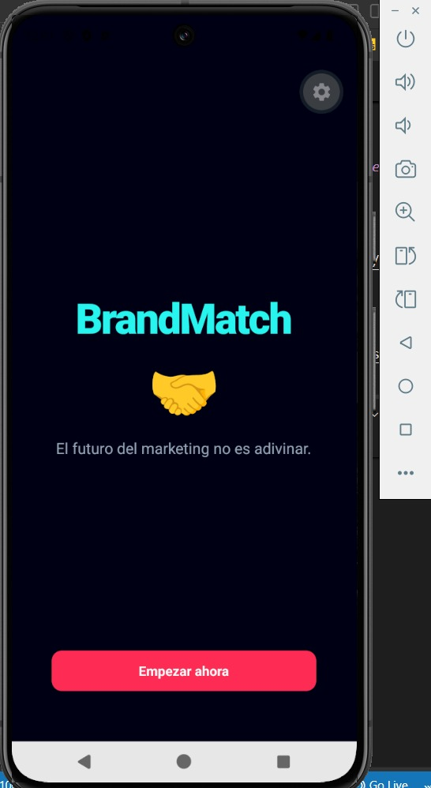
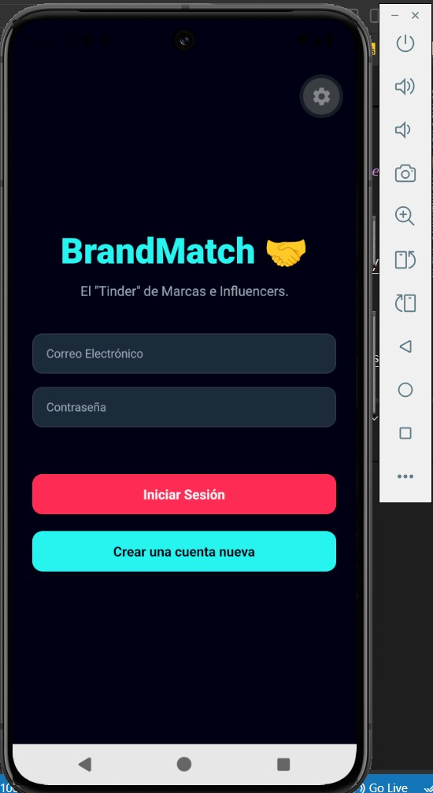
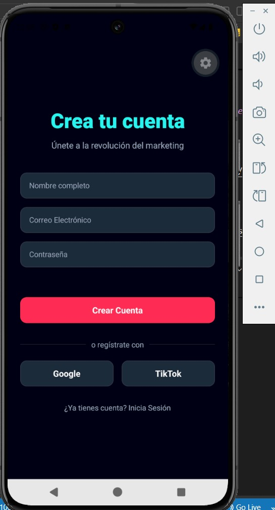
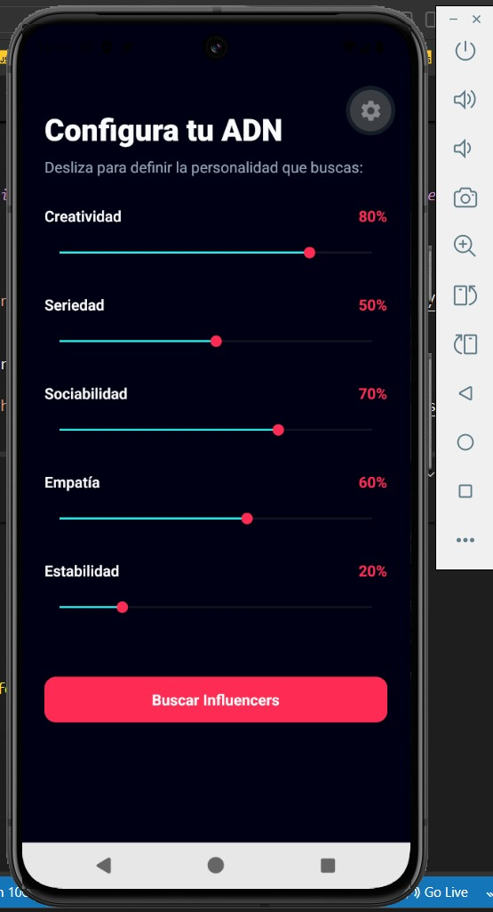
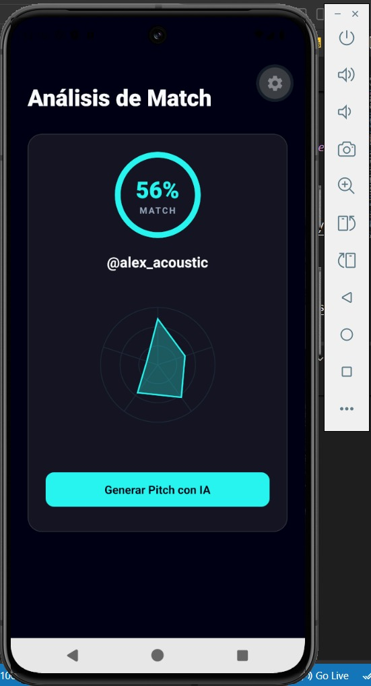
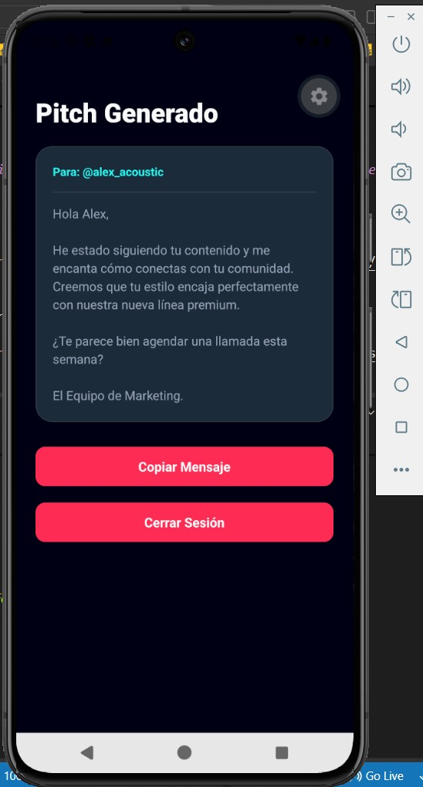

# BrandMatch 🤝 - Pitch Deck & App Prototype

BrandMatch es una plataforma SaaS B2B que utiliza Inteligencia Artificial y el modelo psicológico **Big Five** para emparejar marcas con los influencers perfectos, midiendo su afinidad real y no solo sus seguidores.

Este repositorio contiene el **prototipo funcional de la aplicación móvil** desarrollado en **React Native** con **Expo**, trasladando fielmente el diseño UI/UX creado en Figma.

---

## 📱 Capturas de Pantalla (UI/UX)

*(Aquí puedes subir las fotos de tu app. Si tienes las imágenes en tu PC, arrástralas aquí en VS Code y se crearán los enlaces automáticamente)*

| Pantalla de Bienvenida | Login | Registro |
| :---: | :---: | :---: |
|  |  |  |

| Configuración ADN (Sliders) | Análisis de Match (Radar) | Pitch IA |
| :---: | :---: | :---: |
|  |  |  |

---

## 🚀 Características Principales

- **Autenticación simulada:** Flujo completo de Login y Registro con estados de carga (simulando latencia de red).
- **Diseño interactivo:** Uso de la API nativa `Animated` para transiciones suaves, efecto "latido" y escalado en botones al presionar.
- **Configuración Big Five:** Sliders interactivos que definen la personalidad buscada por la marca.
- **Reactividad de Estado:** Los valores elegidos en los sliders afectan directamente el porcentaje final del Match.
- **Data Visualization:** Gráfico de radar (SVG) para mostrar el ADN del influencer.
- **Glassmorphism UI:** Implementación del efecto de cristal traslúcido en las tarjetas usando `expo-blur`.

---

## 🛠️ Tecnologías y Librerías Utilizadas

*   [React Native](https://reactnative.dev/) - Framework principal.
*   [Expo](https://expo.dev/) - Plataforma de desarrollo.
*   [React Navigation](https://reactnavigation.org/) - Navegación nativa entre pantallas (Native Stack).
*   [@react-native-community/slider](https://github.com/callstack/react-native-slider) - Componente de deslizador nativo.
*   [react-native-svg](https://github.com/software-mansion/react-native-svg) - Para dibujar el gráfico de radar (Big Five).
*   [expo-blur](https://docs.expo.dev/versions/latest/sdk/blur-view/) - Para el efecto visual de cristal (Glassmorphism).

---

## 📂 Arquitectura del Proyecto

El proyecto sigue un diseño **modular y escalable** bajo los principios de Atomic Design:

```text
PruebaBrandMatch/
├── src/
│   ├── components/     # Componentes reutilizables (CustomButton, RadarChart)
│   ├── navigation/     # Configuración de rutas y stack (AppNavigator)
│   ├── screens/        # Pantallas de la app (Welcome, Login, Match, etc.)
│   └── theme/          # Design System (Colores, fuentes globales)
├── App.js              # Punto de entrada y contenedores principales
└── package.json        # Dependencias del proyecto

## ⚙️ Cómo ejecutar el proyecto localmente

Si deseas probar este prototipo en tu propia computadora, sigue estos sencillos pasos:

### Requisitos previos

* Tener instalado [Node.js](https://nodejs.org/) (versión LTS recomendada).
* Tener instalada la aplicación **Expo Go** en tu celular (disponible en Play Store y App Store) o un emulador de Android (como Android Studio).
* Contar con Visual Studio Code u otro editor de código.

### Pasos para la instalación

1. **Clonar el repositorio:**
   Abre tu terminal y ejecuta el siguiente comando para descargar el código:
   ```bash
   git clone https://github.com/TU-USUARIO/BrandMatch-App.git
   ```
   *(Recuerda reemplazar `TU-USUARIO` con tu nombre de usuario real de GitHub).*

2. **Acceder a la carpeta del proyecto:**
   ```bash
   cd BrandMatch-App
   ```

3. **Instalar las dependencias:**
   Descarga todas las librerías necesarias (React Navigation, Slider, Expo Blur, etc.):
   ```bash
   npm install
   ```

4. **Iniciar el servidor de desarrollo de Expo:**
   ```bash
   npx expo start
   ```
   *(Si es la primera vez que lo ejecutas, puedes usar `npx expo start -c` para limpiar la caché y evitar errores).*

5. **Abrir la aplicación:**
   * **En un emulador:** Presiona la tecla `a` en la terminal para abrir la app en Android Studio.
   * **En un dispositivo físico:** Escanea el código QR que aparece en la terminal con la cámara de tu celular (si usas iOS) o desde la app **Expo Go** (si usas Android).
   * **En el navegador:** Presiona la tecla `w` para abrir la versión web.

---

## 👨‍💻 Autores

**Kevin Amaguaña - Jordan Guaicha - Jefferson Marcaya - Dayana Pilatuña -Erick Pulamarín**
* **Proyecto:** BrandMatch - Pitch Deck & App Prototype
* **Área:** Desarrollo Frontend Móvil con React Native.