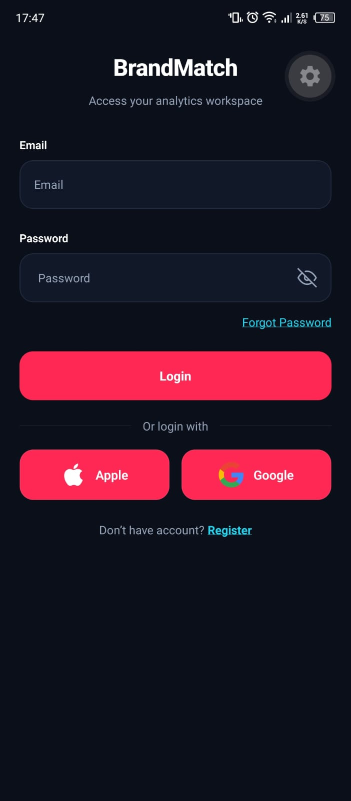
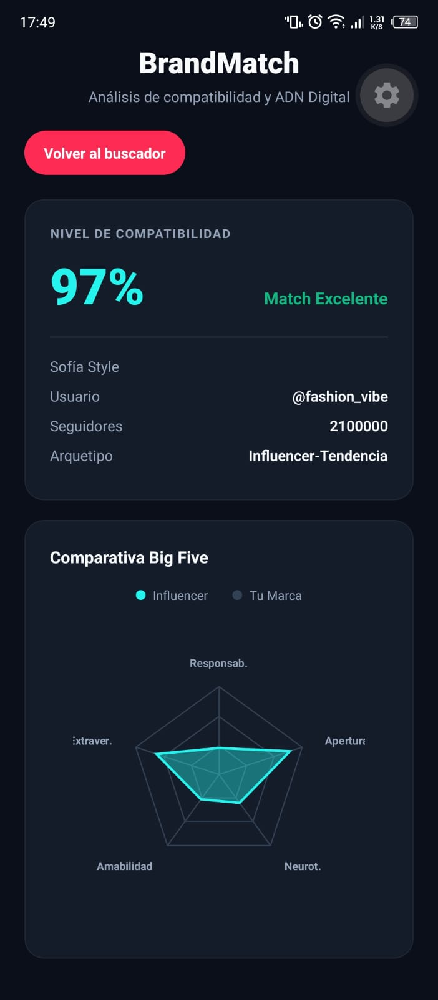
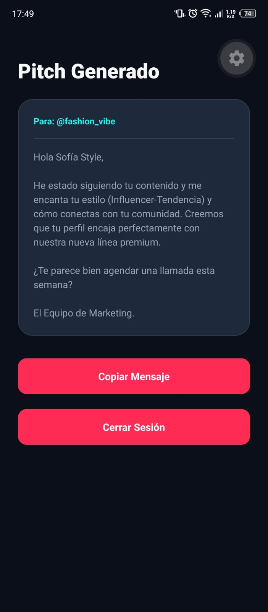

# BrandMatch 🤝 - Plataforma SaaS B2B de Emparejamiento Marca–Creador

**BrandMatch** es una aplicación móvil SaaS B2B que utiliza Inteligencia Artificial y el modelo psicológico **Big Five (OCEAN)** para emparejar marcas con creadores de contenido ideales, midiendo la afinidad real de personalidad y valores por encima de métricas superficiales.

El proyecto está desarrollado en **React Native con Expo Go** bajo una **Arquitectura en Capas orientada al Dominio (DDD)** con principios de **Clean Architecture**, **Inyección de Dependencias** y **Atomic Design**, trasladando el sistema de diseño construido en **Figma** y alimentándose del pipeline de extracción y análisis psicométrico **PractScrapyTtk**.

---

## 🔗 Enlaces Oficiales y Entregables del Proyecto

| Recurso / Entregable | Enlace Directo | Descripción |
| :--- | :--- | :--- |
| **🎨 Prototipo Interactivo (Figma)** | [Ver Prototipo en Figma](https://www.figma.com/proto/hZZLmnQJlWEa1W4fg9ImRf/BrandMatch-Prototipo?node-id=1-2&starting-point-node-id=1%3A2&t=7Y00eWz3GUwOEqPF-1) | Diseño UI/UX completo en Dark Mode (`8px` grid), Atomic Design y vistas responsivas (`9:16`, `16:9`, `1:1`). |
| **📄 Informe Técnico Final** | [Ver Informe Final (`Reporte_Final_BrandMatch.pdf`)](./docs/Reporte_Final_BrandMatch.pdf) | Documento académico completo con fundamentos DDD, arquitectura, pruebas y trazabilidad *(actualizar enlace si se aloja en Drive/OneDrive)*. |
| **📊 Presentación Ejecutiva (Diapositivas)** | [Ver Diapositivas de Sustentación](https://docs.google.com/presentation/d/1fKVn0Se_fRhxd-1JM1vqYXem5NBWvXEQ/edit?usp=sharing&ouid=115547854198529635935&rtpof=true&sd=true) | Presentación del problema, origen de datos, arquitectura `src/` y demostración responsiva *(reemplazar con el enlace final de la presentación)*. |
| **🕷️ Repositorio del Scraper (`PractScrapyTtk`)** | [Ir al repositorio](https://github.com/empulamarin11/PractScrapyTtk.git) | Módulo Extractor TikTok + Groq LLM | Scraper en Python/Playwright que extrae métricas públicas y estima perfiles Big Five. |

---

## 📋 Tabla de Contenido

1. [Presentación, Objetivos y Alcance](#-1-presentación-objetivos-y-alcance)
2. [Problema del Negocio y Pipeline de Datos](#-2-problema-del-negocio-y-pipeline-de-datos)
3. [Modelo de Negocio](#-3-modelo-de-negocio)
4. [Prototipo en Figma, Capturas de Pantalla y Responsividad](#-4-prototipo-en-figma-capturas-de-pantalla-y-responsividad)
5. [Arquitectura de Software y Metodología DDD](#-5-arquitectura-de-software-y-metodología-ddd)
6. [Estructura Real del Repositorio (`src/`)](#-6-estructura-real-del-repositorio-src)
7. [Estado Real del Proyecto](#-7-estado-real-del-proyecto)
8. [Inteligencia Artificial y Prompts Empleados](#-8-inteligencia-artificial-y-prompts-empleados)
9. [Limitaciones Técnicas y Consideraciones Éticas](#-9-limitaciones-técnicas-y-consideraciones-éticas)
10. [Flujo de Trabajo en Git y Responsables](#-10-flujo-de-trabajo-en-git-y-responsables)
11. [Ejecución Local](#-11-ejecución-local)

---

## 🎯 1. Presentación, Objetivos y Alcance

### Objetivo General
Desarrollar un prototipo funcional de aplicación móvil bajo **Domain-Driven Design (DDD)** que permita a las marcas calibrar su identidad psicológica (**ADN Digital**), calcular su nivel de compatibilidad con creadores de contenido perfilados mediante el modelo **Big Five** y generar propuestas comerciales personalizadas (**Pitch**).

### Objetivos Específicos
- Estructurar el código móvil en cuatro capas desacopladas (`domain`, `application`, `infrastructure`, `presentation`) con inversión de dependencias mediante un *Composition Root* (`src/container.js`).
- Integrar perfiles psicográficos obtenidos desde el scraper de TikTok y análisis con LLM (**Groq**) en el dominio de emparejamiento (`src/domain/match/`).
- Implementar reglas de validación inmutables (*Objetos de Valor*) para el flujo de autenticación y registro de marcas.
- Adaptar la interfaz móvil en modo oscuro a relaciones de aspecto **`9:16`**, **`16:9`** y **`1:1`**, manteniendo legibilidad y proporción en distintas resoluciones y densidades de píxeles.

### Delimitación del Alcance

| Incluye (Implementado en el Prototipo) | No Incluye (Fases Posteriores) |
| :--- | :--- |
| Flujo completo de 7 pantallas navegables en Expo Go (`Welcome`, `Login`, `Registro`, `ForgotPassword`, `Configuracion`, `Match`, `Pitch`). | Conexión en tiempo real a un servidor backend o base de datos relacional en la nube. |
| Validaciones de dominio puras e inmutables (`Email`, `FullName`, `Password`, `NewPassword`) y manejo tipado de errores (`ValidationError`, `NotConfiguredError`). | Autenticación OAuth real con proveedores externos (Apple / Google Sign-In) ni envío real de correos de recuperación. |
| Calibración interactiva de 5 rasgos de marca (`0%–100%`), catálogo de creadores perfilados con Big Five y cálculo matemático de compatibilidad. | Diagnóstico psicológico clínico validado (los puntajes Big Five son estimaciones comerciales orientativas). |
| Visualización vectorial pentagonal (`RadarChart.js` en SVG) y generación dinámica de *Pitch* con copiado al portapapeles. | Envío automatizado de correos B2B desde la app ni extracción en vivo desde TikTok dentro del dispositivo móvil. |

---

## 🔍 2. Problema del Negocio y Pipeline de Datos

### El Problema
En el marketing de influencers actual, las decisiones suelen tomarse por intuición o métricas vanidosas (número bruto de seguidores), lo que genera tres fallos críticos:
- **El 60% de las campañas fracasan** por desalineación entre los valores de la marca y la personalidad real del creador.
- **Inflación de métricas:** El volumen de seguidores no garantiza afinidad comunicativa ni conexión auténtica con la audiencia.
- **Selección manual e inescalable:** Evaluar perfiles uno por uno consume tiempo y carece de criterios objetivos auditables.

### Origen de los Datos: Evolución del Scraper (`PractScrapyTtk`) a `BrandMatch`
La información de los creadores que alimenta `src/domain/match/Influencer.js` proviene de un pipeline previo de extracción y análisis psicométrico desarrollado desde cero en Python:

1. **Extracción Pública (Playwright):** Navegación automatizada sin APIs oficiales leyendo el bloque `#__UNIVERSAL_DATA_FOR_REHYDRATION__` e interceptando respuestas XHR de TikTok.
2. **Análisis Paralingüístico (`emoji`):** Conteo de emojis en biografías y descripciones de videos para detectar señales emocionales.
3. **Inferencia Big Five (API de Groq):** Evaluación de rasgos **OCEAN** (*Apertura, Responsabilidad, Extraversión, Amabilidad y Neuroticismo*) y asignación de un **arquetipo comunicativo** por creador.

| Versión Inicial (`PractScrapyTtk` — Web/CLI) | Evolución Actual (`BrandMatch` — App Móvil DDD) |
| :--- | :--- |
| Script monolítico en Python con dashboard en Streamlit. | Aplicación móvil multiplataforma en React Native + Expo Go con arquitectura DDD en 4 capas. |
| Muestra los rasgos Big Five del creador de forma aislada. | Cruza el perfil Big Five del creador contra los 5 rasgos calibrados por la marca (`MatchCalculator.js`). |
| Exportación estática a archivos `resultado_*.json`. | Repositorio desacoplado (`InfluencerRepository.js`) que abstrae el origen de datos para la UI móvil. |
| Análisis descriptivo sin herramienta de contacto comercial. | Generación inmediata de propuesta B2B (*Pitch*) lista para copiar y enviar al creador. |

---

## 💼 3. Modelo de Negocio

| Elemento | Descripción |
| :--- | :--- |
| **Segmento de Clientes** | Marcas, emprendimientos y agencias de marketing digital que contratan creadores de contenido. |
| **Propuesta de Valor** | Reducir el riesgo de campañas fallidas mediante emparejamiento psicográfico objetivo (Big Five) y generación instantánea de propuestas comerciales. |
| **Canales** | Aplicación móvil multiplataforma (Android / iOS vía Expo Go) respaldada por motor web de extracción de datos. |
| **Fuentes de Ingresos** | Modelo SaaS B2B: suscripción mensual escalonada según volumen de búsquedas/matches y planes corporativos para agencias. |
| **Recursos Clave** | Pipeline de extracción de datos públicos, motor de inferencia Big Five con IA, algoritmo de compatibilidad y Design System móvil. |
| **Diferenciador** | Sustituye la selección superficial por seguidores con compatibilidad de personalidad medible en 5 dimensiones y un flujo móvil de 3 pasos (*Configurar → Analizar → Contactar*). |

---

## 🎨 4. Prototipo en Figma, Capturas de Pantalla y Responsividad

### 4.1 Capturas de la Aplicación Móvil (Expo Go — Formato `9:16`)

| Bienvenida (`Welcome`) | Autenticación (`Login`) | Registrarse (`Registro`) |
| :---: | :---: | :---: |
|  |  |  |

| Configuración ADN (`Configuracion`) | Análisis de Match (`Match`) | Generador de Pitch (`Pitch`) |
| :---: | :---: | :---: |
|  |  |  |

### 4.2 Evidencias del Prototipo en Figma y Pruebas Responsivas (`16:9` y `1:1`)

| Sistema Atómico en Figma (Atomic Design) | Prueba en Formato `16:9` (Horizontal) | Prueba en Formato `1:1` (Cuadrado / Split) |
| :---: | :---: | :---: |
|  |  |  |

*(Nota: Guardar las capturas del lienzo de Figma y de las pruebas en orientación horizontal/cuadrada en `assets/screenshots/` con esos nombres para su visualización automática).*

### 4.3 Mapeo de Pantallas, Atomic Design y Contextos DDD

| # | Pantalla | Acción del Usuario | Nivel Atomic Design / Componentes | Contexto DDD Asociado |
| :---: | :--- | :--- | :--- | :--- |
| 1 | `WelcomeScreen` | Visualiza la propuesta de valor e inicia el flujo. | Página con animaciones nativas (`Animated`) y scroll responsivo. | Presentación / Entrada |
| 2 | `loginScreen` | Ingresa credenciales para acceder al espacio de trabajo. | Página + Átomos `EyeIcon`, `EyeOffIcon`, `AppleIcon`, `GoogleIcon`. | Identidad y Acceso (`auth`) |
| 3 | `RegistroScreen` | Crea una cuenta nueva validando nombre, correo y contraseña. | Página + Validación reactiva por campo (`ValidationError`). | Identidad y Acceso (`auth`) |
| 4 | `ForgotPasswordScreen` | Solicita enlace de recuperación de contraseña. | Página + Manejo de errores de dominio (`NotConfiguredError`). | Identidad y Acceso (`auth`) |
| 5 | `ConfiguracionScreen` | Calibra los 5 sliders de marca y elige un influencer en el modal. | Organismo (Sliders + `Modal` `FlatList` + `CustomButton`). | Perfilamiento y Match (`match`) |
| 6 | `MatchScreen` | Evalúa el porcentaje de afinidad y el pentágono Big Five. | Organismo (`RadarChart` SVG + Tarjetas métricas + `CustomButton`). | Emparejamiento (`match`) |
| 7 | `PitchScreen` | Revisa y copia el correo personalizado de colaboración. | Página + Tarjeta de propuesta + `CustomButton` + `Clipboard`. | Emparejamiento (`match`) |

### 4.4 Adaptación a Relaciones de Aspecto (`9:16`, `16:9` y `1:1`) y Densidad de Píxeles

| Variable de Pantalla | Implementación Técnica en React Native |
| :--- | :--- |
| **Relación `9:16` (Vertical)** | Estructura vertical adaptable con `SafeAreaView` y `ScrollView` que respeta barras de estado y gestos del sistema. |
| **Relación `16:9` (Horizontal)** | Hook `useWindowDimensions()` para compactar espaciados verticales en `WelcomeScreen` (evitando recortes del botón *Start*) y contenedores centrados (`maxWidth: 480` en autenticación y `maxWidth: 600` en pantallas principales) para evitar estiramiento horizontal. |
| **Relación `1:1` (Cuadrado)** | Dimensionamiento dinámico del gráfico de radar mediante `Math.min(width, height)` para que el pentágono SVG y sus 5 etiquetas se reescalen sin salirse de su tarjeta en ventanas cuadradas o pantalla dividida. |
| **Resolución y Densidad (`dp`)** | Todas las dimensiones y tipografías emplean **píxeles independientes de densidad (`dp`)** escalados automáticamente según el `PixelRatio` del dispositivo (`mdpi`, `xhdpi`, `xxhdpi`), mientras que `RadarChart` y `AuthIcons` son gráficos vectoriales (`react-native-svg`) libres de pixelación. |

---

## 🏗️ 5. Arquitectura de Software y Metodología DDD

### 5.1 Arquitectura Implementada: Arquitectura en Capas (Layered Architecture)

El frontend móvil de **BrandMatch** implementa una **Arquitectura en Capas (*Layered Architecture*)** guiada por **Domain-Driven Design (DDD)** y conectada mediante **Inyección de Dependencias** (`src/container.js`).

#### ¿Por qué es Arquitectura en Capas y no otro patrón?
- **No es Microservicios:** Toda la aplicación móvil se compila y ejecuta como una sola unidad dentro del dispositivo (Expo Go), sin múltiples servidores independientes comunicándose por red.
- **Diferencia frente a Hexagonal:** Siguiendo el criterio definido por el equipo, se optó por una **Arquitectura en Capas** tradicional y limpia porque se adapta de forma directa a las 4 carpetas principales dentro de `src/`, facilitando la lectura y el mantenimiento por módulos.
- **¿Por qué sí es en Capas? (Organización desde `src/`):** El código divide el sistema en cuatro niveles jerárquicos donde cada carpeta cumple una única responsabilidad y respeta la **regla de dependencia hacia adentro** (`Presentation → Application → Domain`):

| Nivel / Capa | Carpeta en `src/` | Responsabilidad en el Sistema |
| :--- | :--- | :--- |
| **1. Presentación** | `src/presentation/` | Renderiza las 7 pantallas en React Native, componentes atómicos (`CustomButton`, `RadarChart`), estilos (`Theme/`) y navegación (`AppNavigator.js`). No realiza cálculos de negocio. |
| **2. Aplicación** | `src/application/` | Contiene los casos de uso (`loginUser.js`, `registerUser.js`, `calculateMatch.js`) que reciben las acciones de la interfaz y coordinan la ejecución del dominio. |
| **3. Dominio** | `src/domain/` | **El núcleo puro.** Aloja las reglas de validación (`Email`, `Password`, `FullName`, `NewPassword`) y la fórmula matemática Big Five (`MatchCalculator.js`) en **JavaScript puro**, sin importar nada de React Native ni Expo. |
| **4. Infraestructura** | `src/infrastructure/` | Gestiona el acceso a datos y servicios externos (`InfluencerRepository.js` y `AuthApi.js`). Permite conectar una API real en el futuro sin modificar las pantallas ni el dominio. |

```text
[ Presentation (Screens / UI) ] ──▶ [ Application (Casos de Uso) ] ──▶ [ Domain (Reglas Puras) ]
                                            ▲                                   ▲
                                            │ (Inyección en container.js)       │ (Implementa contrato)
                                    [ Infrastructure (AuthApi / InfluencerRepository) ]
```

**Ventaja clave:** Al mantener `src/domain/` completamente aislado de React Native y conectar `src/infrastructure/` mediante `src/container.js`, cualquier cambio en la interfaz gráfica o migración hacia un servidor backend real se realiza sin alterar la lógica principal del negocio.
```

---

### 5.2 Diseño Estratégico (DDD)

#### Dominio y Actores
- **Dominio:** Emparejamiento inteligente entre marcas y creadores de contenido de TikTok basado en afinidad psicológica Big Five.
- **Actores:** **Marca / Empresa** (usuario activo que configura su ADN, consulta perfiles y genera propuestas) y **Creador / Influencer** (perfil público analizado y almacenado en el catálogo).

#### Clasificación de Subdominios

| Subdominio | Tipo | Justificación Estratégica |
| :--- | :--- | :--- |
| **Brand Matching (`match`)** | **Principal (*Core*)** | Constituye el diferenciador del negocio: calcula la compatibilidad psicográfica entre marca y creador. |
| **Identity & Access (`auth`)** | **De soporte** | Gestiona el acceso, registro y validación estricta de credenciales de las marcas usuarias. |
| **Creator Profiling (`PractScrapyTtk`)** | **De soporte** | Abastece al sistema con métricas públicas, arquetipos y puntajes Big Five verificados. |
| **Extracción TikTok / Proveedor LLM** | **Genérico** | Componentes intercambiables (Playwright, Groq) aislados del núcleo matemático de la app. |

#### Contextos Acotados

| Contexto Acotado | Responsabilidad (Qué hace) | Fuera de Responsabilidad (Qué NO hace) |
| :--- | :--- | :--- |
| **Autenticación (`auth`)** | Validar formatos de correo, longitud de contraseña, coincidencia de registro y delegar la sesión al contrato `AuthRepository`. | No almacena contraseñas en texto plano ni ejecuta reglas de cálculo Big Five. |
| **Emparejamiento (`match`)** | Proveer el catálogo de creadores (`InfluencerRepository`), calcular el porcentaje de afinidad (`MatchCalculator`) y clasificar el nivel de match. | No realiza scraping directo ni valida credenciales de inicio de sesión. |

#### Lenguaje Ubicuo (*Ubiquitous Language*)

| Término del Dominio | En el Código | Significado en el Negocio | Contexto |
| :--- | :--- | :--- | :--- |
| **ADN Digital (Marca)** | `marca` (`creatividad`, `seriedad`, `sociabilidad`, `empatia`, `estabilidad`) | Vector de personalidad ideal calibrado por la empresa en escala `0–100`. | `match` |
| **Perfil Big Five** | `bigfive` (`a`, `r`, `e`, `am`, `n`) | Puntajes psicográficos del creador en Apertura, Responsabilidad, Extraversión, Amabilidad y Neuroticismo. | `match` |
| **Arquetipo** | `arquetipo` | Categoría comunicativa dominante del creador derivada de sus videos y emojis. | `match` |
| **Puntaje de Match** | `porcentaje` / `matchPct` | Índice entero de compatibilidad (`0%–100%`) calculado por `calcularCompatibilidad()`. | `match` |
| **Estado de Afinidad** | `estado` / `status` | Clasificación cualitativa: *Match Excelente* (`>75%`), *Match Bueno* (`>50%`) o *Match Bajo* (`≤50%`). | `match` |
| **Pitch Comercial** | `mensajePitch` | Propuesta de colaboración personalizada construida con el nombre y arquetipo del creador. | `match` |
| **Objetos de Valor** | `Email`, `Password`, `FullName`, `NewPassword` | Clases inmutables (`Object.freeze`) que encapsulan sus propias reglas de validación. | `auth` |
| **Composition Root** | `src/container.js` | Punto único donde se instancian los adaptadores y se inyectan en los casos de uso. | Global |

---

### 5.3 Diseño Táctico e Invariantes del Dominio

#### Bloques Tácticos, Contratos y Adaptadores

| Capa | Elemento / Archivo | Rol Táctico |
| :--- | :--- | :--- |
| **Dominio** | `Email`, `Password`, `FullName`, `NewPassword` | **Objetos de Valor** inmutables con métodos estáticos `validate()` y `create()`. |
| **Dominio** | `ValidationError`, `NotConfiguredError` | **Excepciones de Dominio** tipadas por campo (`fieldErrors`). |
| **Dominio** | `MatchCalculator.js` (`calcularCompatibilidad`) | **Servicio de Dominio** puro que computa la afinidad entre marca e influencer. |
| **Dominio** | `AuthRepository.js` | **Contrato (Puerto)** que define las operaciones `login()`, `register()` y `requestPasswordReset()`. |
| **Aplicación** | `loginUser.js`, `registerUser.js`, `requestPasswordReset.js` | **Casos de Uso** con inyección de dependencias (`makeLoginUser(authRepository)`). |
| **Aplicación** | `calculateMatch.js` (`ejecutarCalculoMatch`) | **Caso de Uso** que orquesta el cálculo de compatibilidad desde `MatchScreen`. |
| **Infraestructura** | `AuthApi.js` | **Adaptador** que implementa `AuthRepository` (listo para conectar a endpoints REST). |
| **Infraestructura** | `InfluencerRepository.js` (`getInfluencers`) | **Repositorio** que abastece los 11 perfiles simulados de `MOCK_INFLUENCERS`. |

#### Invariantes del Dominio (Reglas de Negocio Verificables)

| # | Regla de Negocio (Invariante) | Dónde se Aplica |
| :---: | :--- | :--- |
| 1 | Todo correo electrónico es obligatorio, se normaliza con `.trim()` y debe cumplir el patrón `/^[^\s@]+@[^\s@]+\.[^\s@]+$/`. | `domain/auth/Email.js` |
| 2 | El nombre completo de registro debe tener al menos **3 caracteres** sin espacios vacíos. | `domain/auth/FullName.js` |
| 3 | Toda contraseña de cuenta nueva exige mínimo **6 caracteres** y debe coincidir exactamente con `repeatPassword`. | `domain/auth/NewPassword.js` |
| 4 | Los objetos de valor instanciados son inmutables mediante `Object.freeze(this)`. | `Email`, `Password`, `FullName`, `NewPassword` |
| 5 | Cada rasgo del ADN de marca se calibra de forma independiente entre `0` y `100` con incremento entero (`step = 1`). | `presentation/Screens/ConfiguracionScreen.js` |
| 6 | El porcentaje de compatibilidad siempre se entrega como entero redondeado (`Math.round`) entre `0%` y `100%`. | `domain/match/MatchCalculator.js` |
| 7 | No se permite calcular un match sin haber seleccionado previamente un creador del catálogo. | `presentation/Screens/ConfiguracionScreen.js` |

---

## 📂 6. Estructura Real del Repositorio (`src/`)

```text
PruebaBrandMatch/
├── assets/
│   └── screenshots/                # Capturas UI/UX de la app y del prototipo Figma
├── docs/
│   └── Reporte_Final_BrandMatch.pdf # Informe técnico institucional
├── src/
│   ├── domain/                     # 1. DOMINIO (Reglas puras e invariantes, sin React)
│   │   ├── auth/
│   │   │   ├── AuthErrors.js
│   │   │   ├── AuthRepository.js
│   │   │   ├── Email.js
│   │   │   ├── FullName.js
│   │   │   ├── NewPassword.js
│   │   │   └── Password.js
│   │   └── match/
│   │       ├── Influencer.js
│   │       └── MatchCalculator.js
│   │
│   ├── application/                # 2. APLICACIÓN (Casos de uso)
│   │   ├── auth/
│   │   │   ├── loginUser.js
│   │   │   ├── registerUser.js
│   │   │   └── requestPasswordReset.js
│   │   └── match/
│   │       └── calculateMatch.js
│   │
│   ├── infrastructure/             # 3. INFRAESTRUCTURA (Adaptadores externos)
│   │   ├── auth/
│   │   │   └── AuthApi.js
│   │   └── match/
│   │       └── InfluencerRepository.js
│   │
│   ├── presentation/               # 4. PRESENTACIÓN (UI React Native + Atomic Design)
│   │   ├── components/
│   │   │   ├── AuthIcons.js
│   │   │   ├── CustomButton.js
│   │   │   └── RadarChart.js
│   │   ├── Navigation/
│   │   │   └── AppNavigator.js
│   │   ├── Screens/
│   │   │   ├── ConfiguracionScreen.js
│   │   │   ├── ForgotPasswordScreen.js
│   │   │   ├── loginScreen.js
│   │   │   ├── MatchScreen.js
│   │   │   ├── PitchScreen.js
│   │   │   ├── RegistroScreen.js
│   │   │   └── WelcomeScreen.js
│   │   └── Theme/
│   │       └── colors.js
│   │
│   └── container.js                # Composition Root (Inyección de dependencias)
│
├── App.js                          # Punto de entrada y carga de tipografía Inter
├── package.json                    # Dependencias y scripts de Expo
├── README.md                       # Documentación principal del sistema
├── README_CONFIGURACION.md         # Manual técnico del módulo Configuración ADN
├── README_LOGIN.md                 # Manual técnico del módulo Login
├── README_MATCH.md                 # Manual técnico del módulo Match y Radar
└── README_REGISTRO.md              # Manual técnico del módulo Registro
```

---

## 📊 7. Estado Real del Proyecto

| Componente / Funcionalidad | Estado Actual | Detalle Técnico |
| :--- | :--- | :--- |
| Ejecución en Expo Go y navegación Native Stack (7 pantallas) | **Funciona** | Operativo en Android e iOS sin encabezados nativos invasivos. |
| Validaciones de dominio en Login y Registro (`Email`, `NewPassword`, `FullName`) | **Funciona** | Validación por campo en tiempo real mediante `ValidationError`. |
| Calibración de 5 sliders Big Five y buscador modal (`FlatList`) | **Funciona** | Actualización reactiva y validación de selección obligatoria. |
| Cálculo matemático de compatibilidad (`MatchCalculator.js`) | **Funciona** | Computa porcentaje entero y clasificación por umbrales. |
| Gráfico pentagonal vectorial (`RadarChart.js`) y responsividad (`9:16`, `16:9`, `1:1`) | **Funciona** | Redimensionamiento dinámico con `useWindowDimensions()` y SVG. |
| Generación y copiado al portapapeles de propuesta comercial (`PitchScreen.js`) | **Funciona** | Plantilla personalizada con `Clipboard.setString` y alerta nativa. |
| Persistencia de usuarios, recuperación de contraseña y OAuth | **Simulado / Pendiente** | `AuthApi.js` mantiene el flujo navegable y lanza `NotConfiguredError` en recuperación. |
| Conexión en vivo con API backend de scraping | **En progreso** | Consume los 11 perfiles estructurados en `MOCK_INFLUENCERS`. |

---

## 🤖 8. Inteligencia Artificial y Prompts Empleados

### 8.1 IA dentro del Producto vs. IA en el Desarrollo

| Herramienta / Modelo | Ámbito | Rol Técnico en el Proyecto |
| :--- | :--- | :--- |
| **Groq LLM (`PractScrapyTtk`)** | **Dentro del producto** | Procesa biografías, descripciones de videos y emojis extraídos de TikTok para puntuar los rasgos Big Five (`0–100`) y clasificar el arquetipo del creador. |
| **Gemini (Google)** | **Durante el desarrollo** | Prompt maestro de concepción del producto SaaS B2B, flujo de pantallas, arquitectura DDD en capas y adaptación responsiva (`9:16`, `16:9`, `1:1`). |
| **Claude (Anthropic)** | **Durante el desarrollo** | Diseño táctico del subdominio `auth`, objetos de valor inmutables (`Email`, `NewPassword`), manejo de errores y *Composition Root* (`src/container.js`). |
| **DeepSeek** | **Durante el desarrollo** | Implementación de pantallas interactivas (`ConfiguracionScreen`, `MatchScreen`, `PitchScreen`), `MatchCalculator.js` y geometría SVG de `RadarChart.js`. |
| **OpenAI Codex / GitHub Copilot** | **Durante el desarrollo** | Asistencia en VS Code para iconos vectoriales (`AuthIcons.js`), animaciones nativas (`Animated`) y tokens visuales en `colors.js`. |

### 8.2 Jerarquía de Prompts Empleados

1. **Nivel 1 — Prompt Maestro de Arquitectura y Producto (`Gemini`):**
   > *"Actúa como arquitecto de producto digital y desarrollador móvil senior. A partir de los datos extraídos del mercado —el 60% de las campañas de influencer marketing fracasan porque las marcas seleccionan creadores solo por seguidores/likes sin evaluar afinidad de valores—, genera la propuesta completa de negocio y la estructura base de una aplicación móvil SaaS B2B llamada BrandMatch desarrollada en React Native con Expo Go. El sistema debe: 1) Analizar los 5 rasgos de personalidad del modelo psicológico Big Five (Apertura, Responsabilidad, Extraversión, Amabilidad y Neuroticismo); 2) Mapear el flujo completo en 7 pantallas (Welcome, Login, Registro, Recuperar Contraseña, Configuración de ADN con sliders, Análisis de Match con gráfico de radar y Generador de Pitch); y 3) Organizar el código bajo Domain-Driven Design (DDD) en 4 capas (`domain`, `application`, `infrastructure`, `presentation`) junto con Atomic Design en modo oscuro (`#0B0F19`, acento cian `#25F4EE` y magenta `#FE2C55`)."*

2. **Nivel 2 — Andamiaje de Dominio e Inyección de Dependencias (`Claude`):**
   > *"Implementa bajo DDD el subdominio `auth` en JavaScript puro sin importar librerías de React. Crea objetos de valor inmutables (`Email`, `Password`, `FullName`, `NewPassword`) con validación estática, errores tipados (`ValidationError`, `NotConfiguredError`), el contrato `AuthRepository`, el adaptador `AuthApi` y los casos de uso (`makeLoginUser`, `makeRegisterUser`, `makeRequestPasswordReset`) conectados mediante un Composition Root en `src/container.js`."*

3. **Nivel 3 — Motor Matemático Big Five, Sliders y Gráfico Radar SVG (`DeepSeek`):**
   > *"Desarrolla `MatchCalculator.js`, `ConfiguracionScreen.js` y `MatchScreen.js` en React Native con Expo Go. Usa `@react-native-community/slider` para calibrar los 5 rasgos de marca, un `Modal` con `FlatList` alimentado por `getInfluencers()` y `react-native-svg` con `useWindowDimensions()` para dibujar el pentágono Big Five en `RadarChart.js` adaptable a relaciones de aspecto `9:16`, `16:9` y `1:1` sin recortes ni desbordamientos."*

4. **Nivel 4 — Generador de Pitch Comercial y Microinteracciones (`DeepSeek` / `Codex`):**
   > *"Implementa `PitchScreen.js` y el átomo reutilizable `CustomButton.js` con animaciones nativas (`Animated.spring` con `useNativeDriver: true`). En `PitchScreen`, recibe el perfil del creador seleccionado, redacta dinámicamente la propuesta comercial B2B personalizada con su nombre y arquetipo comunicativo y permite copiarla al portapapeles con `Clipboard.setString`."*

---

## ⚖️ 9. Limitaciones Técnicas y Consideraciones Éticas

### Limitaciones Técnicas
- **Naturaleza orientativa del perfil:** La estimación Big Five se basa en análisis textual de publicaciones públicas y funciona como apoyo comercial, no como un test psicométrico clínico.
- **Dependencia de texto:** Perfiles sin biografía ni descripciones textuales en sus videos ofrecen menor señal para la inferencia de personalidad.
- **Datos en memoria en el MVP móvil:** La aplicación móvil opera con perfiles preprocesados en `MOCK_INFLUENCERS` mientras se habilita el despliegue del servidor backend.

### Consideraciones Éticas y Privacidad
- **Exclusivamente cuentas públicas:** El pipeline de extracción consulta únicamente perfiles públicos de TikTok sin evadir controles de privacidad ni resolver captchas automáticamente.
- **Uso estrictamente académico:** Todo el sistema fue desarrollado con fines educativos en la Universidad Central del Ecuador, sin explotación comercial de datos de terceros.
- **Protección de credenciales:** Las claves de API (`GROQ_API_KEY`) y archivos de sesión se excluyen del control de versiones mediante `.gitignore` y variables de entorno (`.env`).

---

## 🌿 10. Flujo de Trabajo en Git y Responsables

### Estrategia de Ramas y Commits
- **`main`:** Rama principal de entrega estable.
- **`features` / `feature/<módulo>`:** Ramas de trabajo independiente por funcionalidad (`login-rediseno`, `features`, `feature/match-radar`, `feature/pitch-ui`) integradas hacia `main` mediante **Pull Requests (PR)** y mensajes semánticos (*Conventional Commits*: `feat:`, `fix:`, `docs:`, `refactor:`).

### Asignación de Roles del Equipo

| Integrante | Rol Principal | Responsabilidades y Entregables Técnicos |
| :--- | :--- | :--- |
| **Erick Pulamarín** | Líder de Proyecto, Ingeniería de Datos & Diseño Base (*Product Owner*) | Concepción de la propuesta de negocio SaaS B2B; desarrollo del pipeline de extracción de datos en TikTok y análisis psicométrico Big Five mediante Groq LLM serializado en formato JSON para su consumo en la app; programación de la primera versión funcional completa del frontend; diseño inicial del prototipo en Figma, documentación base y coordinación de la colaboración y flujo de trabajo del equipo. |
| **Jefferson Marcalla** | Arquitectura DDD & Módulo de Autenticación | Reestructuración y organización integral del proyecto hacia una **Arquitectura en Capas** guiada por **Domain-Driven Design (DDD)** (`domain`, `application`, `infrastructure`, `presentation` y `src/container.js`); implementación del flujo de acceso (`loginScreen.js`, `ForgotPasswordScreen.js`), objetos de valor y validaciones puras (`Email.js`, `Password.js`, `AuthErrors.js`), además de auditoría y correcciones técnicas en el `README.md`. |
| **Kevin Amaguaña** | Módulo de Registro, Enrutamiento & Documentación Principal | Implementación del flujo de registro de marcas (`RegistroScreen.js`), caso de uso `registerUser.js` e invariantes de dominio (`FullName.js`, `NewPassword.js`); integración y pruebas de navegación en `AppNavigator.js`, validación de estados de error en formularios y edición estructurada del `README.md` principal del repositorio. |
| **Jordan Guaicha** | Experiencia de Bienvenida, Animaciones & Diseño Adaptativo | Desarrollo de la interfaz de entrada (`WelcomeScreen.js`) con microinteracciones fluidas a 60 FPS mediante la API nativa `Animated` (`useNativeDriver: true`); ingeniería de adaptación responsiva multi-formato para relaciones de aspecto **`9:16`**, **`16:9`** y **`1:1`** utilizando `useWindowDimensions()`, gestión de densidad de píxeles (`dp`) y contenedores flexibles libres de recortes en cualquier resolución. |
| **Dayana Pilatuña** | Módulo Pitch B2B, Sistema Tipográfico & Documentación Final | Desarrollo del generador dinámico de propuestas comerciales (`PitchScreen.js`) con personalización por arquetipo y copiado al portapapeles; integración global de la familia tipográfica **Inter** (`@expo-google-fonts/inter` y `expo-font`) en `App.js` y tokens del *Design System* para garantizar fidelidad estética con Figma; redacción de manuales técnicos y consolidación del informe académico final. |

---

## ⚙️ 11. Ejecución Local

### Requisitos Previos
- **[Node.js](https://nodejs.org/)** (versión LTS).
- Aplicación **Expo Go** instalada en Android/iOS o emulador en Android Studio.

### Instalación y Arranque

```bash
# 1. Clonar el repositorio
git clone [https://github.com/empulamarin11/BrandMatch-App.git](https://github.com/empulamarin11/BrandMatch-App.git)

# 2. Ingresar al directorio
cd BrandMatch-App

# 3. Instalar dependencias
npm install

# 4. Iniciar servidor de desarrollo Expo (limpiando caché)
npx expo start -c
```

Escanea el código QR desde **Expo Go** en tu teléfono o presiona `a` en la terminal para abrirlo en el emulador de Android.

---

**Institución:** Universidad Central del Ecuador — Facultad de Ingeniería y Ciencias Aplicadas (Carrera de Sistemas de Información)  
**Asignatura:** Programación para Dispositivos Móviles  
**Docente:** Ing. Diego Noguera  
**Fecha:** Noviembre 2026