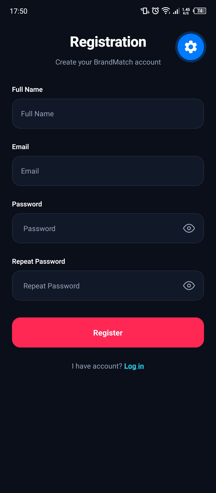
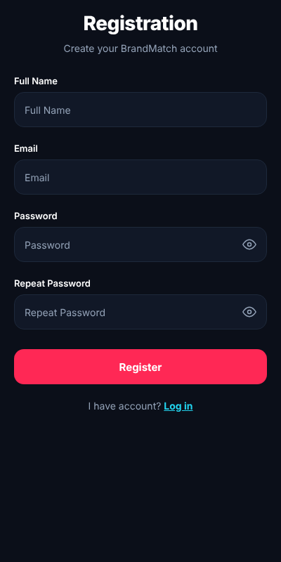

# BrandMatch — Módulo de Registro

**Repositorio:** empulamarin11/BrandMatch-App
**Rama:** `registro`
**Pantalla del sorteo:** P3 – Registro

## 1. Descripción

Rediseño de la pantalla de creación de cuenta de BrandMatch según el prototipo de
Figma, y organización de su lógica con la metodología Domain-Driven Design (DDD),
siguiendo la misma estructura que el módulo de Login. El trabajo se hizo sobre el
proyecto existente, sin crear uno nuevo ni modificar el backend.

El módulo es un prototipo de interfaz funcional: el registro está preparado pero
aún no conectado a un servidor.

## 2. Vista previa

| Antes | Después (diseño de Figma) |
| :---: | :---: |
|  |  |

## 3. Tecnologías y herramientas

| Elemento | Uso |
|---|---|
| React Native + Expo | Framework de la aplicación móvil |
| JavaScript | Lenguaje del proyecto |
| `StyleSheet`, `TextInput`, `Pressable`, `SafeAreaView`, `KeyboardAvoidingView`, `ScrollView` | Componentes nativos de la interfaz |
| `react-native-svg` (vía `AuthIcons.js`) | Ícono del ojo para mostrar u ocultar contraseñas |
| Visual Studio Code | Editor de código |
| Android Studio / Expo Go | Pruebas de la interfaz |
| Git y GitHub | Control de versiones y trabajo colaborativo |

## 4. Metodología: Domain-Driven Design (DDD)

### 4.1 Archivos del módulo de Registro

```
src/
├── domain/auth/                  ← reglas del negocio
│   ├── FullName.js               ← NUEVO: objeto de valor del nombre completo
│   ├── NewPassword.js            ← NUEVO: objeto de valor de la contraseña de una cuenta nueva
│   ├── Email.js                  ← (reutilizado del Login) regla del correo
│   ├── AuthRepository.js         ← se agregó el contrato register()
│   └── AuthErrors.js             ← (reutilizado) ValidationError
├── application/auth/             ← casos de uso
│   └── registerUser.js           ← NUEVO: "Crear cuenta"
├── infrastructure/auth/          ← conexión con el exterior
│   └── AuthApi.js                ← se agregó register() (backend pendiente)
├── presentation/
│   ├── screens/RegistroScreen.js ← interfaz de la pantalla
│   └── components/AuthIcons.js   ← (reutilizado) EyeIcon / EyeOffIcon
└── container.js                  ← se agregó registerUser
```

### 4.2 Capas y responsabilidades

| Capa | Responsabilidad en el Registro | Depende de |
|---|---|---|
| Dominio | Reglas de `FullName`, `Email` y `NewPassword`; contrato `register()` | Nada |
| Aplicación | `registerUser` valida todos los campos y llama al repositorio | Dominio |
| Infraestructura | `AuthApi.register()` implementa el contrato (backend pendiente) | Dominio |
| Presentación | `RegistroScreen` muestra el formulario, los errores y el estado de carga | Aplicación |

`container.js` es el único archivo que conoce todas las capas: decide que
`registerUser` utiliza `AuthApi`.

### 4.3 Conceptos DDD aplicados

| Concepto | Aplicación en el Registro |
|---|---|
| Contexto delimitado | Identidad y Acceso (`auth`), compartido con el Login |
| Lenguaje ubicuo | `FullName`, `Email`, `NewPassword`, `registerUser`, `register` |
| Objetos de valor | `FullName` y `NewPassword` (nuevos) y `Email` (reutilizado) |
| Repositorio | `AuthRepository.register()` define el contrato; `AuthApi` lo implementa |
| Caso de uso | `registerUser` |
| Errores de dominio | `ValidationError` con un mensaje por campo |

`NewPassword` es distinto de `Password` a propósito: para iniciar sesión basta con
que la contraseña no esté vacía, pero para crear una cuenta se exige un largo
mínimo y que se repita igual.

### 4.4 Flujo de registro

```text
RegistroScreen ──registerUser({...})──▶ registerUser (aplicación)
                                           │ valida con FullName, Email y NewPassword (dominio)
                                           ├─ si hay errores → ValidationError → la pantalla los muestra debajo de cada campo
                                           └─ si todo está bien → AuthApi.register() (infraestructura)
                                                                     └─▶ "✓ Account Created!" → Configuración
```

## 5. Reglas de validación

| Campo | Regla | Mensaje |
|---|---|---|
| Full Name | Obligatorio | `Full name is required.` |
| Full Name | Mínimo 3 caracteres | `Full name must be at least 3 characters.` |
| Email | Obligatorio | `Email is required.` |
| Email | Formato `texto@texto.texto` | `Enter a valid email address.` |
| Password | Obligatoria | `Password is required.` |
| Password | Mínimo 6 caracteres | `Password must be at least 6 characters.` |
| Repeat Password | Obligatoria | `Please repeat your password.` |
| Repeat Password | Igual a *Password* | `Passwords do not match.` |

Se validan todos los campos a la vez y cada error aparece debajo de su campo, con
el borde en rojo. Al escribir en un campo, su error desaparece.

## 6. Funcionalidades de la interfaz

- Campos *Full Name*, *Email*, *Password* y *Repeat Password*, cada uno con su etiqueta encima.
- Cada contraseña tiene su propio ícono de ojo para mostrarla u ocultarla.
- Al tocar *Register* se muestra un circulito de carga; si todo es correcto, el botón cambia a **"✓ Account Created!"** y se pasa a Configuración.
- El botón no responde a un doble toque mientras carga.
- `KeyboardAvoidingView` + `ScrollView` evitan que el teclado tape el formulario.
- Mismas medidas, colores (`COLORS` de `theme/colors.js`) e íconos que el Login, para que las pantallas de autenticación se vean iguales.

## 7. Navegación

```text
Login ──("Register")──▶ Registro ──(Register)──▶ Configuración
                           │
                           └──("Log in")──▶ Login
```

## 8. Cómo probarlo

```bash
npm install
npx expo start -c
```

Abrir la app (tecla `a` para el emulador, `w` para el navegador o escanear el QR
con Expo Go), tocar **"Empezar ahora"** y luego **"Register"**.

### Casos de prueba

| Acción | Resultado esperado |
|---|---|
| Tocar *Register* con todo vacío | Los 4 campos en rojo, cada uno con su mensaje |
| Escribir un correo como `kevin@gmail` | `Enter a valid email address.` |
| Usar una contraseña de 3 caracteres | `Password must be at least 6 characters.` |
| Escribir dos contraseñas distintas | `Passwords do not match.` |
| Tocar el ícono del ojo | La contraseña se muestra; al tocarlo otra vez se oculta |
| Llenar todo correctamente y tocar *Register* | Circulito de carga → "✓ Account Created!" → Configuración |
| Tocar *Log in* | Va a la pantalla de Login |

## 9. Pendiente

- Conectar `AuthApi.register()` con el backend real cuando exista.
